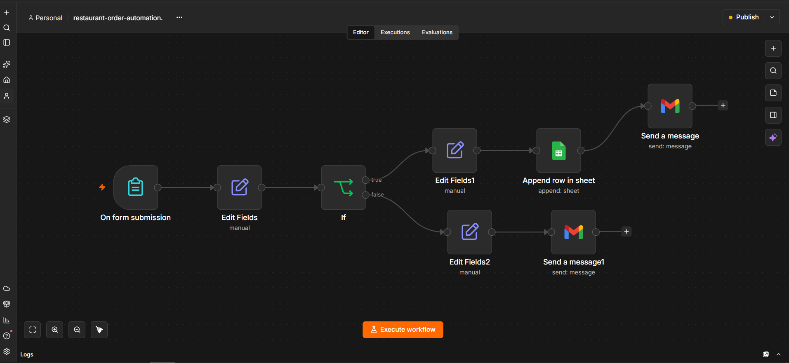
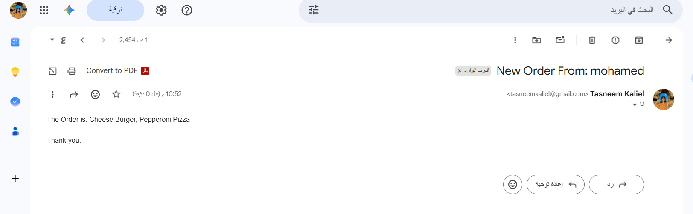
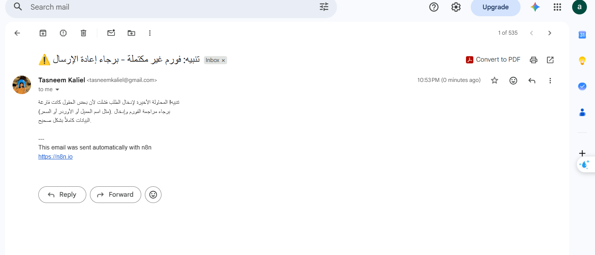
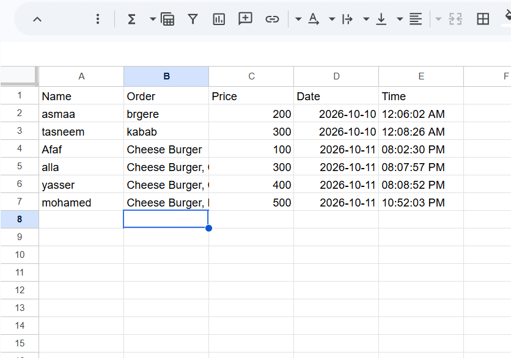

# 🍔 Restaurant Order Automation (n8n)

An **n8n workflow** that automates restaurant order handling: it collects orders through a web form, validates the data, logs every valid order in **Google Sheets**, and notifies the kitchen by **Gmail**. Incomplete submissions trigger an alert email instead.

Inspired by the Krusty Krab from *SpongeBob*: the cashier takes the order, the chef prepares it, and here the workflow connects the two automatically. 😄

---

## 📌 Workflow Overview



| # | Node | Type | Purpose |
|---|------|------|---------|
| 1 | **On form submission** | Form Trigger | Customer enters name, selects order items (checkboxes) and price |
| 2 | **Edit Fields** | Set | Cleans the data, converts the order array to text, adds date and time |
| 3 | **If** | Condition | Validates that name, order and price are not empty |
| 4 | **Edit Fields1** | Set | Marks valid orders as `ready_for_confirmation` |
| 5 | **Append row in sheet** | Google Sheets | Saves the order as a new row |
| 6 | **Send a message** | Gmail | Sends the new order details to the kitchen |
| 7 | **Edit Fields2** | Set | Marks invalid submissions as `empty` |
| 8 | **Send a message1** | Gmail | Sends an alert that the form was incomplete and must be resubmitted |

---

## ⚙️ How It Works

1. The customer fills out the **Orders** form: name, items (Cheese Burger, Chicken Burger, Margherita Pizza, Pepperoni Pizza, Chicken Ranch Pizza) and price.
2. **Edit Fields** formats the data and adds `order_date` and `order_time` automatically.
3. The **If** node checks that `customer_name`, `order` and `price` are all non-empty.
4. **✅ Valid:** the order is appended to Google Sheets, then an email with the order is sent.
5. **❌ Invalid:** an alert email is sent asking for the form to be completed and resubmitted. Nothing is written to the sheet.

---

## 🧩 Challenge & Solution

**Problem:** The checkbox field returns the selected items as an **Array**. Storing it as-is caused the order to appear incorrectly in both the Google Sheet and the email.

**Solution:** Convert the array into a readable string in the `Edit Fields` node:

```js
{{ $json['Write Your Order'].join(', ') }}
```

So selecting several items produces a clean value like `Cheese Burger, Pepperoni Pizza`.

---

## 📸 Results

### ✅ Successful order: email to the kitchen


### ❌ Incomplete form: alert email


### 📊 Google Sheets log


The sheet contains these columns: `Name` | `Order` | `Price` | `Date` | `Time`

---

## 🛠️ Tech Stack

- **n8n** (workflow automation)
- **Google Sheets** (order storage)
- **Gmail** (notifications)
- n8n expressions (JavaScript)

---

## 🚀 Getting Started

1. Import `restaurant-order-automation.json` into n8n (**Workflows → Import from File**).
2. Connect your own credentials:
   - **Gmail OAuth2**
   - **Google Sheets OAuth2**
3. In **Append row in sheet**, select your own spreadsheet with the columns `Name, Order, Price, Date, Time`.
4. In both Gmail nodes, set the recipient email addresses.
5. Open the form URL from the **On form submission** node and submit a test order.
6. Publish the workflow to use the production form URL.

> 🔒 Credentials are not included in the repository. Use your own.

---

## 💡 What I Learned

- Data validation and conditional logic with the **If** node
- Handling data types (**Arrays vs Strings**)
- Connecting Google Sheets and Gmail in a single workflow
- Small bugs can teach big lessons

---

## 🙏 Acknowledgments

Special thanks to **Eng. Karim Nabil** for his guidance and support throughout this project.

---

## 📁 Repository Structure

```
├── restaurant-order-automation.json
├── images/
│   ├── workflow.png
│   ├── order-email.png
│   ├── alert-email.png
│   └── google-sheet.png
└── README.md
```

---

## 👩‍💻 Author

**Asmaa**: Computer Vision & AI Engineer
